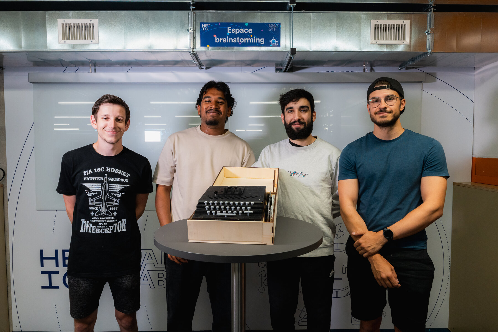
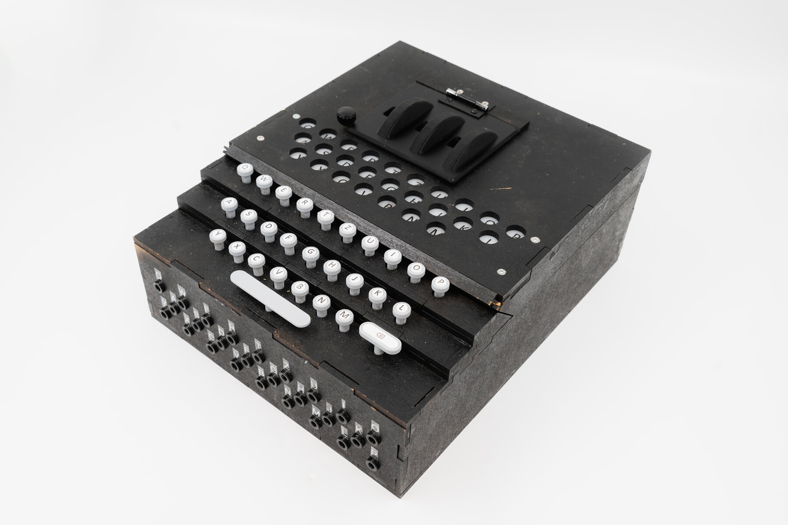
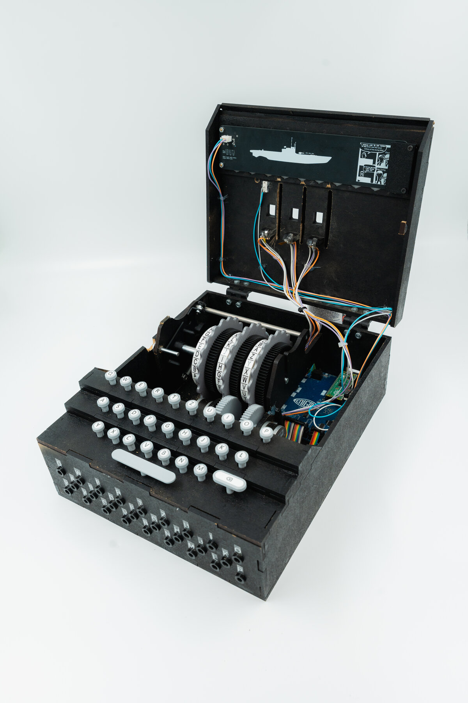

# ENIGMA Embedded System

An educational, electromechanical Enigma-machine prototype developed as a 2026 multidisciplinary project at HEIG-VD.

The project combines an Enigma cipher implementation, embedded firmware, custom electronics, a physical keyboard and lampboard, sensors, and motor-driven rotors in a functional prototype.



## Overview

The prototype recreates the core operating principles of the historical Enigma machine with modern embedded hardware. A key press is read from the physical keyboard, processed through the configurable rotor and reflector model, and displayed on the LED lampboard. Stepper motors reproduce rotor movement, while magnetic and analog sensors monitor the physical state of the mechanism.

The repository contains:

- the integrated Raspberry Pi Pico firmware;
- a standalone C implementation of the cipher;
- focused hardware test programs;
- KiCad sources for the custom circuit boards;
- project documentation, schematics, poster, and prototype photographs.

## Main features

- Reversible Enigma encryption and decryption
- Configurable rotor wiring, position, and offset
- Automatic rotor stepping
- Matrix keyboard input
- WS2812B LED lampboard output
- Stepper-motor rotor actuation
- Plugboard scanning through I/O expanders
- Rotor identification and position sensing
- Modular test programs for individual subsystems

## Hardware and software

### Embedded platform

- Raspberry Pi Pico
- Arduino framework through PlatformIO
- WS2812B addressable LEDs
- PCA95x5 I/O expanders
- MCP3008 ADC
- Stepper motors and magnetic sensors

### Main dependencies

PlatformIO installs the firmware dependencies declared in [`platformio.ini`](Firmware/EnigmaV1/platformio.ini):

- Adafruit NeoPixel
- Adafruit MCP3008
- Adafruit BusIO
- PCA95x5
- RPI Pico Timer Interrupt

The standalone cipher test requires a C11-compatible GCC toolchain and `make`.

## Repository structure

```text
.
├── Firmware/
│   └── EnigmaV1/          Integrated PlatformIO firmware
├── Hardware/
│   ├── KiCad/             PCB schematics and layouts
│   └── io-assignment.drawio
├── Tests/                 Algorithm and hardware subsystem tests
├── docs/
│   ├── images/            Prototype photographs
│   ├── poster/            Project poster source
│   ├── report/            Report and requirements document
│   └── schematics/        PDF schematics and I/O diagram
├── .gitignore
└── README.md
```

## Build the firmware

Install [PlatformIO](https://platformio.org/), then run:

```bash
cd Firmware/EnigmaV1
pio run
```

Connect the Raspberry Pi Pico and upload the firmware with:

```bash
pio run --target upload
```

The exact upload procedure can depend on the Pico boot mode and the locally detected serial or USB device.

## Build the standalone cipher test

```bash
cd Tests/algorithme
make
./app
```

Clean the generated files with:

```bash
make clean
```

## Hardware design

The [`Hardware/KiCad`](Hardware/KiCad) directory contains the editable KiCad sources for four custom boards:

- main controller board;
- keyboard board;
- LED board;
- Hall-sensor board.

Reference exports are available in the documentation:

- [Main-board schematic](docs/schematics/main-board-schematic.pdf)
- [Keyboard schematic](docs/schematics/keyboard-schematic.pdf)
- [I/O assignment diagram](docs/schematics/io-assignment.png)

## Documentation

- [Project report (DOCX)](docs/report/enigma-report.docx)
- [Functional requirements (PDF)](docs/report/requirements.pdf)
- [Project poster (PPTX)](docs/poster/enigma-poster.pptx)
- [Firmware file overview](Firmware/EnigmaV1/FILE_TREE.md)

## Prototype gallery

| Overall prototype | Internal mechanism |
| --- | --- |
|  |  |

## Project status

The repository represents the final functional academic prototype delivered in 2026. The programs under `Tests/` document the incremental validation work; the integrated implementation is under `Firmware/EnigmaV1/`.

## Usage notice

This repository is published as an academic and portfolio project. No open-source license has been selected yet; unless a license is added, the project remains protected by copyright and reuse is not automatically granted.
